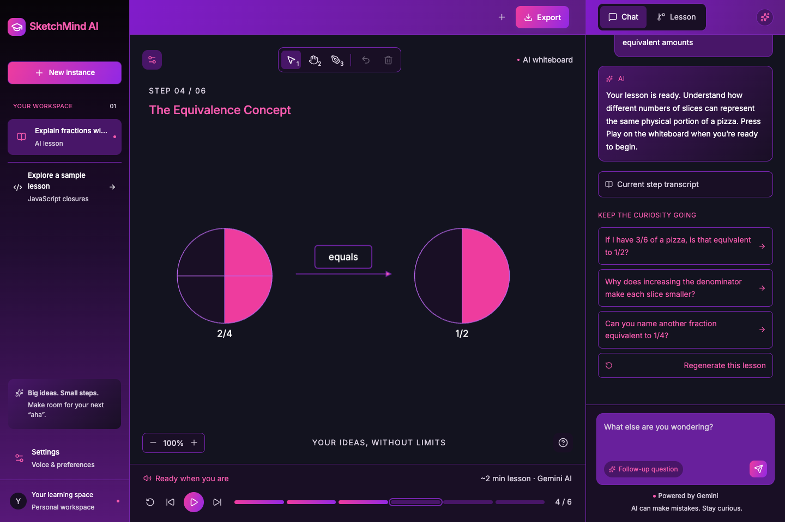

# SketchMind AI

AI + Visual Whiteboard Learning.

SketchMind AI helps beginners understand programming, mathematics, and science through short visual lessons. Learners enter a topic, watch its diagrams while listening to narration, revisit any step, and ask contextual follow-up questions. The interface follows the supplied three-panel reference: workspace navigation, central whiteboard, and tutor chat.

Built for the Braynix Studios AI Whiteboard Tutor assignment. The project uses live Gemini generation; it is not a frontend-only mockup.

## Features and application flow

1. Enter an educational topic or select a suggestion in Chat.
2. The server generates a narration targeting approximately two minutes as structured JSON.
3. Zod validates the lesson and diagram elements before returning them.
4. Press Play to start browser narration. Each speech completion activates the next diagram.
5. Pause/resume, restart, previous/next, or select a step using the progress bars and Lesson tab.
6. Ask a follow-up or click a suggested question; Gemini receives the topic, summary, and bounded recent conversation. Its answer does not interrupt or replace the lesson.
7. Optionally choose **Explain on Whiteboard** below an AI follow-up answer. Gemini generates a new visual lesson focused on that question and its original context. Only successful generation replaces the board, resets narration, and shows a “New whiteboard explanation” notice. Press Play to start the new narration.
8. Reopen the previous lesson from workspace history, including its chat. Reopening an already generated explanation reuses it without another API call. History is in memory and retains up to 12 lessons.

The board supports text, rectangles, circles, arrows, lines, highlights, nested concept containers, zoom, pan, freehand annotations, undo, clearing annotations, and PNG export. Transcripts remain available without audio. Desktop uses three panels; mobile stacks the whiteboard above chat.

## Stack

Next.js 16 App Router, React 19, TypeScript, Tailwind CSS 4 and custom CSS, Lucide icons, official `@google/genai`, Zod 4, React Konva/Konva, browser SpeechSynthesis, Vitest, and Playwright. Frontend and server route handlers share one repository. No database, registration, or separate Express service is needed.

## Project structure

```text
app/
  api/chat/route.ts       # Contextual Gemini answers
  api/health/route.ts     # Safe health response
  api/lessons/route.ts    # Structured generation and validation
  globals.css
  layout.tsx
  page.tsx
components/
  Board.tsx              # Client-only responsive Konva renderer
  LessonPlayer.tsx       # Speech status and step controls
  Sidebar.tsx            # In-session lessons and sample entry
  Tutor.tsx              # App composition, requests, chat state
hooks/usePlayer.ts       # Shared speech and step controller
lib/
  ai.ts                  # SDK, prompts, request limits, safe errors
  chat.ts                # Follow-up source context and message types
  diagramLayout.ts       # Local diagram collision repair and label bounds
  demo.ts                # Explicit prewritten sample
  lesson.ts              # Types, schemas, diagram bounds
  speech.ts              # Replaceable VoiceService abstraction
tests/
  api.test.ts
  lesson.test.ts
  live.test.ts           # Opt-in paid provider verification
  speech.test.ts
  e2e/tutor.spec.ts       # Desktop/mobile interaction checks
.env.example
next.config.ts
postcss.config.mjs
playwright.config.ts
vitest.config.mts
```

## Installation and local development

Use Node.js 24 LTS and npm. From the project directory:

```sh
npm ci
cp .env.example .env.local
```

Set these server-only variables in `.env.local`:

```dotenv
GEMINI_API_KEY=your_gemini_api_key
GEMINI_MODEL=gemini-3.1-flash-lite
```

Obtain a key in [Google AI Studio](https://aistudio.google.com/apikey). Enable the required API access and quota in its Google Cloud project. The model is configurable because model access and availability vary. This implementation was verified with `gemini-3.1-flash-lite`; another listed model returned 503 during verification. See [Google's model documentation](https://ai.google.dev/gemini-api/docs/models) and [structured output documentation](https://ai.google.dev/gemini-api/docs/structured-output).

Use your own valid Gemini credential for local development. A key configured only in Vercel must also be configured separately in local `.env.local` when running locally. Never commit credentials or use `NEXT_PUBLIC_` for secrets.

```sh
npm run dev
```

Open http://localhost:3000. For a production preview:

```sh
npm run build
npm run start
```

The production build uses Next's webpack option because Turbopack's CSS loader could not bind its subprocess port in the development sandbox. Tailwind runs through the standard PostCSS integration.

## Frontend/backend and AI architecture

The client sends same-origin JSON requests with `fetch`. `POST /api/lessons` validates the topic, calls Gemini on the server, parses structured JSON, and applies the strict Zod lesson schema. Only validated data reaches the renderer. `POST /api/chat` builds an educational prompt from bounded lesson context and conversation history. Gemini is never called from a browser component.

Gemini receives a shape-only JSON schema because repeating numeric/string/array limits inside nested elements exceeded the fast model's constraint budget. The complete strict Zod schema still enforces sizes, allowed types, hex colors, unique IDs, and coordinate bounds after generation. Invalid provider output returns a friendly error, never a substituted sample response.

The server gives lesson calls a 25-second provider timeout, retries transient provider failures once, and permits one quality-regeneration pass within the 120-second function budget. Chat calls use a 55-second provider timeout and one transient retry. It limits request bodies to 24 KB while reading the stream, rejects cross-origin browser requests, and applies a basic per-process 12 requests/minute/IP limit. Rate limiting relies on trusted proxy IP headers on the deployed platform. It is suitable only for a small demo; use a durable shared limiter and platform firewall for sustained public traffic. It resets on cold starts and does not coordinate across server instances.

The client aborts obsolete requests and uses generation IDs to prevent stale responses from replacing a newer lesson. Follow-up chat does not stop playback. Starting or switching lessons cancels narration. Workspace history is held in React state and disappears on refresh; no learner data is persisted.

## API

### POST /api/lessons

```json
{ "topic": "JavaScript Closures", "level": "beginner" }
```

The same endpoint also accepts an optional `followUp` object for an explicitly requested visual explanation:

```json
{
  "topic": "JavaScript Closures",
  "level": "beginner",
  "followUp": {
    "question": "Why does the inner function remember a variable?",
    "summary": "The original lesson summary.",
    "answer": "The AI follow-up answer shown in chat."
  }
}
```

The original topic stays bounded to 240 characters; the follow-up question supports up to 1,200 characters, its summary 1,500, and the prior answer 3,000. Context is validated and treated as untrusted data. The lesson prompt focuses on answering the question rather than repeating the original topic.

Returns a lesson with `title`, `topic`, `objective`, `steps`, `summary`, and `suggestedQuestions`. Every step has `id`, `title`, `narration`, `estimatedDurationSeconds`, and `elements`. Each visual step completely replaces the previous diagram. Topics must be 2–240 characters; lessons have 3–10 steps, up to 18 elements/step.

### POST /api/chat

```json
{
  "topic": "JavaScript Closures",
  "summary": "A function retains access to its lexical environment.",
  "history": [{ "role": "user", "content": "What is a closure?" }],
  "question": "Why does the inner function remember the variable?"
}
```

Returns `{"answer":"..."}`. Only user/assistant roles are accepted. Questions are at most 1,200 characters; the server permits at most 10 bounded history messages, subject to the total request size. The frontend sends at most six truncated recent messages.

### GET /api/health

Returns `{"success":true,"message":"AI Whiteboard Tutor API is running"}` without exposing configuration. This is a liveness endpoint, not proof of provider availability.

Errors use `{"error":"Human-readable message"}` with 400 for validation, 403 for forbidden origins, 413 for oversized bodies, 429 for throttling/quota, 502 for provider/diagram failures, and 503 for missing configuration.

## Whiteboard design

Diagrams use a logical 960 × 600 coordinate space scaled into the available panel. The renderer accepts only the schema's seven primitive types; it never executes generated HTML, SVG, or JavaScript. Rectangles/circles carry labels, nested rectangles group ideas, and arrows connect concepts. Line width/height represent signed deltas, allowing horizontal, vertical, and backwards arrows. Both endpoints must remain in bounds. Non-line shapes must have a visible size. The `fraction` primitive adds a validated integer `numerator` and `denominator` (up to 12) to draw genuinely partitioned wholes. The AI chooses this primitive for part-of-whole explanations; no topic-specific lesson is hardcoded.

After layout repair, every element is validated again. If a cramped hierarchy cannot fit, it becomes a bounded relationship diagram with explicit containment connectors. Arrow and line labels are positioned near their connectors. On mobile, the canvas scrolls at a readable scale instead of reducing text to single-digit pixel sizes. Tap a label to read its full text if it is truncated. Selecting a new lesson resets the drawing tool and palette.

Konva is loaded in a client-only dynamic component, avoiding browser APIs during server rendering. A ResizeObserver updates responsive scaling. Drawings are separate local annotations, so learner strokes cannot modify AI data. PNG export captures the current visible board.

## Voice synchronization and engineering decisions

`VoiceService` abstracts narration; `BrowserVoice` supplies the browser implementation and can later be replaced with provider TTS. It selects an available English voice, avoids overlapping utterances, and detaches old callbacks during cancellation.

`usePlayer` owns both the current step and narration status. Starting a step updates its diagram and speaks its narration; the utterance's `onend` advances to the next step. A generation token rejects callbacks from canceled speech. Pause/resume uses the actual speech service. Seeking cancels current speech and displays the selected step; pressing Play starts that step from its beginning.

Step-based synchronization was chosen because SpeechSynthesis does not offer reliable timestamp seeking across browsers. The progress bars represent steps, not a fake elapsed-audio clock. Live narration must contain 300–370 words, targeting about two minutes. A short, overlong, or invalid lesson triggers one complete Gemini regeneration, never hardcoded filler. Duration estimates are calculated from the returned narration at 160 words/minute instead of trusting provider guesses. Actual speech length still depends on the device voice; it is not guaranteed to be exactly 120 seconds. There are no independent visual timers that can advance while narration is paused. If speech is unsupported, users can read transcripts and navigate manually.

## Live versus sample behavior

- New lessons and follow-ups use the real Gemini SDK and the configured API key.
- “Explore a sample lesson” loads the prewritten closure example in `lib/demo.ts`. The board and chat explicitly label it as sample content, not live AI. It is shorter than the target live lesson.
- Speech uses the operating system/browser voice, not prerecorded audio.
- Routine unit tests mock Gemini; browser tests mock API responses and SpeechSynthesis. They validate interactions without spending API quota or claiming audible playback was heard.
- The opt-in live test actually calls Gemini for a full lesson, a contextual follow-up answer, and a second visual lesson based on that answer. A separate native Chrome verification measured a generated 318-word lesson at 119.1 seconds, with all six speech/diagram steps completing in order.

## Testing

```sh
npm test
npm run typecheck
npm run lint
npm run build
npm run test:e2e
```

Browser tests use installed Google Chrome via Playwright's `chrome` channel and run against a production server on port 3100. Install Chrome before running them, or adjust the channel in `playwright.config.ts`. The test server starts automatically if no existing server is running there. Desktop and mobile Chromium flows verify topic submission, canvas rendering, narration text, pause/resume, seeking, restart, follow-ups, errors, sample labeling, speech completion, stale callback cancellation, optional visual explanations, duplicate-click protection, failed-generation retries, and cancellation while starting a new topic. Desktop checks also restore the previous lesson and cached visual explanation from workspace history.

To explicitly make paid live API calls:

```sh
LIVE_AI=1 node --env-file=.env.local node_modules/vitest/vitest.mjs run tests/live.test.ts
```

Verification completed during implementation: 33 unit/API/speech/layout/quality tests passed; 14 desktop/mobile browser tests passed; the separate real-Gemini lesson/answer/visual-follow-up test passed; TypeScript, ESLint (no warnings), and production build passed. Ordinary `npm test` skips the live test intentionally.

## GitHub and Vercel deployment

Source: https://github.com/mayur1212/sketchmind-ai

Public application: https://sketchmind-ai-woad.vercel.app

The homepage and health endpoint are publicly accessible. Production Gemini generation, contextual chat, optional visual follow-ups, native narration controls, and workspace history have been verified on the public URL. The owner updated the provider credential during setup; the final production checks succeeded. For another account, follow these steps:

1. Create a GitHub repository. Verify `.env.local` is ignored with `git check-ignore .env.local`.
2. Review changes and commit the source:

   ```sh
   git add .
   git commit -m "Build SketchMind AI whiteboard tutor"
   git branch -M main
   git remote add origin https://github.com/YOUR_USERNAME/ai-whiteboard-tutor.git
   git push -u origin main
   ```

3. In Vercel, choose **Add New → Project**, import the repository, and use its detected Next.js preset. Keep the repository root as the project root and `npm run build` as the build command. Use Node.js 24.
4. Add `GEMINI_API_KEY` and `GEMINI_MODEL=gemini-3.1-flash-lite` as server environment variables for Production and Preview. Use your own key from its secure source, never copy it into source code.
5. Deploy. After a successful deployment, open the returned public URL and `/api/health`.
6. Generate a real topic, play/pause/seek/restart the narration, and ask a follow-up. Check mobile usability and provider quota. Only then submit the verified URL.

Vercel account access is required for publication. Function duration is set to 120 seconds; ensure the hosting plan supports this duration. Runtime Gemini credentials belong in Vercel environment variables, never in source or build artifacts.

## Known limitations and next improvements

- Publication status is listed under assignment submission links.
- Browser narration varies by operating system and voice; automated tests verify calls and events, not perceived audio quality. Step-level seeking is intentional.
- Diagram readability is prompted and validated structurally, but semantic label overlap and factual AI mistakes can still occur. Retry/regenerate is available.
- Sessions and drawings are in-memory only. Refreshing clears them.
- The screenshot's PDF import and separate animation-generation service are outside this implementation; there are no inert buttons claiming those capabilities.
- Export is the current viewport, including annotations. It is not a full lesson video or PDF export.
- The demo limiter is process-local. Add durable distributed limiting, spend caps, and monitoring before serving substantial traffic.
- Future work: provider TTS with word timestamps, saved lessons, more sophisticated automatic diagram layout, PDF context, improved keyboard interaction within canvas, and learning checks.

## Assignment submission links

- [Official assignment](https://github.com/Braynix-Studios/ai-whiteboard-tutor-assignment)
- [Submission form](https://docs.google.com/forms/d/e/1FAIpQLSdFJoTxMEuFZrCHTbEgv7bbg2uLf33SjP7n0w2qUONR4kMRcA/viewform)
- Source repository: https://github.com/mayur1212/sketchmind-ai
- Live demo: https://sketchmind-ai-woad.vercel.app (live Gemini lesson/chat/visual follow-up and native playback controls verified).

## Verification evidence



See [verification notes](docs/verification.md) for tests, native speech timing, mobile behavior, and the remaining human listening check.
